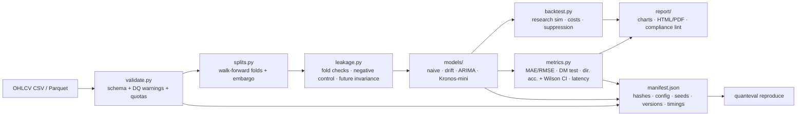

# Kozphy QuantEval Cloud

**Reproducible evaluation reports for financial forecasting models. It produces evidence, not trading signals.**

[](https://github.com/Kozphy/quanteval-cloud-public/actions/workflows/ci.yml)

> Research tool. **Not investment advice.** It evaluates *models*, not securities, and makes no claim that any model or strategy is profitable. See the [Disclaimer](#disclaimer).

---

## What it does and why

Quant researchers and fintech teams keep getting asked whether a forecasting model (for example a financial foundation model such as Kronos) beats simple baselines on *their* data, and whether that result can be trusted. Answering that properly takes a chronological split, leakage controls, baselines, significance tests and a record that someone else can re-run. That work is easy to get subtly wrong.

`quanteval` takes one OHLCV series and produces:

1. **A validated input.** Schema and data-quality checks, with any warnings stated explicitly.
2. **An out-of-sample, walk-forward comparison** of Kronos-mini against naive, drift and ARIMA baselines.
3. **Accuracy statistics with uncertainty**: error metrics, Diebold–Mariano tests against naive, and directional accuracy with confidence intervals.
4. **A research backtest that includes costs.** It is reported separately from accuracy and suppressed when it would not be meaningful.
5. **An HTML/PDF report and a `manifest.json`**, so `quanteval reproduce` can re-run the evaluation and check the results match.

Current stage: **concierge CLI (Milestone 1)**. There is no hosted service, web UI or multi-tenant API yet (see [Roadmap](#roadmap)).

## Features (implemented in `src/quanteval`)

| Area | What is implemented | Module |
|---|---|---|
| Input validation | CSV/Parquet OHLCV loading. Hard failures: missing columns, bad timestamps, non-positive prices, high < low, duplicate or unsorted timestamps. Warnings: `DQ-TZ`, `DQ-GAP`, `DQ-ZEROVOL`, `DQ-STALE`, `DQ-EXTREME`, `DQ-SPLIT` | `validate.py` |
| Walk-forward splits | Chronological expanding-window origins, configurable `embargo_bars` (default 0), `step >= horizon` enforced so evaluation windows never overlap, structural fold checks | `splits.py`, `config.py` |
| Leakage controls | Structural fold assertions. A **future-invariance check** perturbs every bar after each origin; forecasts must not change. A **negative control** (`LookaheadModel`, deliberately leaky) must be detected, or the run aborts. A pretraining-shadow warning (`LK-SHADOW`) covers origins near the foundation model's training cut-off and release date | `leakage.py`, `harness.py` |
| Models | `naive` (last close), `drift` (mean log-return), `arima` (statsmodels ARIMA on log close, configurable order and refit stride), `kronos_mini` (vendored Kronos code, pinned Hugging Face revisions, CPU, per-origin seeds) | `models/` |
| Metrics | MAE, RMSE, MAPE, end-of-horizon MAE, MAE relative to naive. **Diebold–Mariano** test on squared errors against naive. Directional accuracy with a **Wilson 95% CI** and binomial p-value against 50%. Per-forecast latency p50/p95 | `metrics.py` |
| Research backtest | Exposure from the sign of the forecast move, delayed execution (`delay_bars >= 1` enforced), `long_short` or `long_flat`, cost per side plus a **cost-sensitivity sweep**, gross/net return, annualised Sharpe, max drawdown, hit rate, passive reference. **Suppressed** for models that never take exposure (e.g. naive), or when there are fewer than `min_trades` active periods, hard data-quality errors, or a failed leakage check | `backtest.py` |
| Report | Jinja2 HTML with embedded charts (out-of-sample forecasts, rolling error, error distribution, rolling directional accuracy, latency, research equity, cost sensitivity). PDF via WeasyPrint (optional). A **compliance lint** rejects buy/sell/signal/recommend/guarantee wording | `report/` |
| Manifest and reproduce | `manifest.json` records the input sha256, config, seeds, package versions, hardware, git commit, timings and estimated compute cost. `quanteval reproduce` checks the input hash, re-runs, and compares predictions (exact for deterministic models, relative tolerance 1e-6 for Kronos) and metrics | `environment.py`, `reproduce.py` |
| Quotas | Max rows, file size, lookback, horizon, origins and a run timeout (see [Limits](#limits-and-quotas)) | `config.py`, `validate.py`, `harness.py` |
| License gate | `scripts/check_licenses.py` fails on GPL/AGPL (non-LGPL) or Commons Clause dependencies. Runs in CI | `scripts/` |

## Install

Requires Python ≥ 3.10. CI and the commands below were verified on Python 3.12, Linux, CPU only.

```bash
git clone https://github.com/Kozphy/quanteval-cloud-public.git
cd quanteval-cloud-public
python3.12 -m venv .venv && . .venv/bin/activate
pip install --upgrade pip
# CPU-only torch (same pin as CI), then the package with Kronos, PDF and test extras
pip install --index-url https://download.pytorch.org/whl/cpu torch==2.14.1
pip install -e '.[kronos,pdf,dev]'
```

- Install extras `kronos` (torch, einops, huggingface_hub, safetensors, tqdm) only if you need the `kronos_mini` model, and `pdf` (WeasyPrint) only if you need PDF output. WeasyPrint needs Pango system libraries (`libpango-1.0-0 libpangoft2-1.0-0` on Debian/Ubuntu).
- The first Kronos run downloads the pinned Kronos-mini weights and tokenizer from Hugging Face into the local HF cache.

## Quickstart

All of these were run on a fresh clone on 2026-10-10:

```bash
# 1. Generate a synthetic OHLCV series (no real market data)
python examples/synthetic_ohlcv.py --out data.csv

# 2. Validate only (prints a JSON summary: sha256, rows, range, frequency, warnings)
quanteval validate --csv data.csv

# 3. Full benchmark: naive, drift, ARIMA, Kronos-mini; writes report.html, report.pdf, manifest.json, predictions.csv, charts/
quanteval run --csv data.csv --horizon 5 --out out/

#    Faster, baselines only, no PDF (about 10 s on the dev box)
quanteval run --csv data.csv --models naive,drift,arima --no-pdf --out out_fast/

# 4. Re-run from the manifest and compare
quanteval reproduce --manifest out/manifest.json --csv data.csv --out out_repro/

# 5. Re-create the published synthetic sample from its config
quanteval run --csv reports/inputs/synthetic_daily.csv --config reports/configs/synthetic.yaml --out out_cfg/
```

`python -m quanteval ...` works too. On the dev box, step 5 produced a `predictions.csv` byte-identical to `reports/sample-synthetic/run1/predictions.csv`.

## CLI reference

From `quanteval --help`:

```text
usage: quanteval [-h] {run,reproduce,validate} ...

Financial forecasting model benchmark (research only)

positional arguments:
  {run,reproduce,validate}
    run                 run a benchmark and write
                        report.html/report.pdf/manifest.json
    reproduce           re-run from a manifest and compare results
    validate            validate a CSV only
```

```text
usage: quanteval run [-h] --csv CSV --out OUT [--config CONFIG]
                     [--horizon HORIZON] [--lookback LOOKBACK]
                     [--max-origins MAX_ORIGINS] [--models MODELS]
                     [--title TITLE] [--provenance DATA_PROVENANCE] [--no-pdf]

  --csv CSV             OHLCV CSV (or .parquet)
  --out OUT
  --config CONFIG       YAML/JSON config file
  --horizon HORIZON
  --lookback LOOKBACK
  --max-origins MAX_ORIGINS
  --models MODELS       comma-separated: naive,drift,arima,kronos_mini
  --title TITLE
  --provenance DATA_PROVENANCE
  --no-pdf

usage: quanteval reproduce [-h] --manifest MANIFEST --csv CSV --out OUT
usage: quanteval validate  [-h] --csv CSV [--config CONFIG]
```

Example config (`reports/configs/synthetic.yaml`):

```yaml
horizon: 5
lookback: 256
min_history: 128
max_origins: 150
seed: 42
models: [naive, drift, arima, kronos_mini]
arima_order: [1, 1, 1]
kronos: {sample_count: 5, temperature: 1.0, top_p: 0.9, threads: 4}
backtest: {mode: long_short, cost_bps_per_side: 5.0, cost_sensitivity_bps: [0, 5, 10, 25], delay_bars: 1, min_trades: 30}
```

## Sample results

These numbers are copied from the `manifest.json` of a real run on 2026-10-10. The code was commit `d1295a5` in the private development history, and `src/`, `tests/` and `pyproject.toml` are identical in this repo. Full details, backtest tables, runtime and reproducibility evidence are in [`reports/README.md`](reports/README.md).

> **Caveat:** this is **one configuration** (horizon 5, lookback 256, ARIMA(1,1,1), Kronos-mini zero-shot, 5 samples) on **one synthetic series**. It does not show that any model is generally better or worse. A sample on public crypto data exists privately pending data-licensing review.

**Synthetic GARCH daily** (134 origins, 2024-05-09 → 2026-03-05). MAE/RMSE are in price units over all 5 steps.

| Model | MAE | RMSE | MAPE | MAE/naive | DM stat (p) vs naive | Dir. acc. (hits/n) | 95% CI | p vs 50% |
|---|---|---|---|---|---|---|---|---|
| naive | 1.17733 | 1.55580 | 1.3708% | 1.0000 | n/a | n/a (flat forecast) | n/a | n/a |
| drift | 1.19769 | 1.57551 | 1.3948% | 1.0173 | 1.457 (0.147) | 48.5% (65/134) | 40.2–56.9% | 0.796 |
| arima | 1.17543 | 1.55156 | 1.3687% | 0.9984 | −0.546 (0.586) | 54.5% (73/134) | 46.0–62.7% | 0.342 |
| kronos_mini | 1.40833 | 1.81976 | 1.6551% | 1.1962 | 3.172 (0.0019) | 49.3% (66/134) | 40.9–57.6% | 0.931 |

> A sample on public crypto data exists privately pending data-licensing review.

In this configuration, Kronos-mini zero-shot had about 20% higher MAE than naive on the synthetic series (DM p = 0.0019). No model's directional accuracy was statistically different from 50%. Measured runtime for the full report on an 8-vCPU Xeon dev box was 35.80 s in-process, with Kronos-mini at 166.1 ms p50 per forecast. That gives an estimated US$0.0044/report at Cloud Run Jobs list price with 1-minute minimum billing. This is an estimate, not a bill.

## Architecture



`harness.py` orchestrates the run, and `cli.py` is the entry point. The planned hosted architecture (async jobs, scale-to-zero, cost controls) is described in [`docs/technical-architecture.md`](docs/technical-architecture.md) and is **not built yet**.

## Project layout

```text
src/quanteval/
  cli.py, __main__.py      CLI entry points (run / reproduce / validate)
  harness.py               end-to-end orchestration
  config.py                RunConfig, Limits, Kronos/backtest config, pinned revisions
  validate.py              OHLCV loading + validation
  splits.py, calendar.py   walk-forward folds, future timestamps
  leakage.py               negative control, future-invariance checks
  models/                  naive.py, arima.py, kronos.py, base.py
  metrics.py, backtest.py  accuracy statistics, research backtest
  report/                  charts.py, render.py, compliance.py, templates/
  environment.py           versions, hardware, git info, cost estimate
  reproduce.py             manifest-driven re-run + comparison
  _vendor/kronos/          vendored Kronos model code (MIT, see VENDORED.md)
tests/                     pytest suite (validation, splits, leakage, metrics, backtest, Kronos, e2e, compliance/licenses)
examples/                  synthetic data generator + sample CSV
reports/                   sample runs (configs, inputs, reports, manifests, reproducibility evidence)
scripts/check_licenses.py  dependency license gate
docs/                      business, legal, product and architecture docs
```

## Testing

```bash
python scripts/check_licenses.py   # license gate
pytest -q                          # 80 tests
```

There are **80 tests** (`80 passed` locally and in CI on 2026-10-10). They cover validation, fold construction, the leakage detector including the negative control, metrics, the backtest, Kronos-mini determinism (this downloads the pinned weights), end-to-end runs with reproduce, and the report compliance lint. CI (`.github/workflows/ci.yml`) runs the license gate and the full suite on Ubuntu with Python 3.12 and CPU torch on every push and pull request.

## Reproducibility

- Each run writes `manifest.json` with the input file sha256, full config, seeds, package versions, CPU/thread info, git commit and dirty flag, Kronos model/tokenizer revisions, and per-stage timings.
- `quanteval reproduce` refuses to run if the input hash differs. It compares predictions exactly for deterministic models and within a relative tolerance of 1e-6 for Kronos-mini, and also compares accuracy metrics. Latency and wall time are excluded by design.
- For the synthetic sample, the two runs produced identical `predictions.csv` hashes (max |diff| = 0.0), including Kronos-mini, on the same machine, thread count and seed. **Bitwise equality across different CPUs or torch builds is not guaranteed and has not been tested.**

## Limits and quotas

Defaults from `config.Limits`. A violation raises `QuotaError`.

| Limit | Default |
|---|---|
| Max rows | 200,000 |
| Max file size | 50 MB |
| Max lookback | 2,048 bars (Kronos-mini context length) |
| Max horizon | 60 bars |
| Max walk-forward origins | 500 |
| Run timeout | 1,800 s |

Other rules enforced in config: `step >= horizon`, `embargo_bars >= 0`, `delay_bars >= 1`, and `mode` must be `long_short` or `long_flat`.

Known gaps:
- Single asset per run.
- CPU only.
- The DM test uses a simplified small-sample correction suited to non-overlapping origins.
- No fine-tuning.
- Larger models (Chronos, TimesFM, Kronos-small/base) are not integrated.
- WeasyPrint may warn about missing HarfBuzz-subset, which only makes PDFs larger.

## Roadmap

| Stage | Status | Docs |
|---|---|---|
| Stage 0: repo audit, feasibility, legal/licensing, competitors, MVP spec | Completed (desk research; legal review **Blocked** pending counsel) | [repository-audit](docs/repository-audit.md), [commercial-feasibility](docs/commercial-feasibility.md), [legal-and-licensing-checklist](docs/legal-and-licensing-checklist.md), [competitive-landscape](docs/competitive-landscape.md), [mvp-prd](docs/mvp-prd.md), [first-task-summary](docs/first-task-summary.md) |
| Milestone 1: reproducible single-asset benchmark CLI + sample reports | Completed | [m1-acceptance](docs/m1-acceptance.md), [reports/README](reports/README.md) |
| Customer discovery and paid concierge pilots | **Blocked** (outreach needs founder approval; nothing sent, no customers yet) | [customer-discovery](docs/customer-discovery.md), [go-to-market-30-days](docs/go-to-market-30-days.md), [paid-pilot-proposal](docs/paid-pilot-proposal.md), [pricing-experiments](docs/pricing-experiments.md) |
| Payments (PayPal invoicing / Paddle) | Unimplemented (needs founder action; Paddle AUP review pending) | [legal-and-licensing-checklist](docs/legal-and-licensing-checklist.md), [unit-economics](docs/unit-economics.md) |
| Stage 3: async evaluation service; Stage 5: cost controls | Unimplemented (designed) | [technical-architecture](docs/technical-architecture.md), [unit-economics](docs/unit-economics.md) |
| Stage 6: multi-tenant SaaS | Unimplemented (only after the Stage 9 gate passes) | [technical-architecture](docs/technical-architecture.md), [stage-gate-criteria](docs/stage-gate-criteria.md) |
| Risk tracking | Completed (draft) | [launch-risk-register](docs/launch-risk-register.md) |

## Documentation index

| Doc | Contents |
|---|---|
| [docs/repository-audit.md](docs/repository-audit.md) | Audit of the source repos and Kronos: licenses, tests, reuse verdicts, flagged secrets |
| [docs/commercial-feasibility.md](docs/commercial-feasibility.md) | Stage 0 feasibility verdict, segments, risks |
| [docs/competitive-landscape.md](docs/competitive-landscape.md) | Competitors, open-source alternatives, DIY threat |
| [docs/legal-and-licensing-checklist.md](docs/legal-and-licensing-checklist.md) | Taiwan/US advisory boundary, payment providers, data/model licensing (not legal advice) |
| [docs/mvp-prd.md](docs/mvp-prd.md) | Concierge MVP product requirements |
| [docs/first-task-summary.md](docs/first-task-summary.md) | Minimum sellable offer, budget, 30-day validation plan, M1 definition |
| [docs/m1-acceptance.md](docs/m1-acceptance.md) | Milestone 1 acceptance checklist with evidence |
| [docs/customer-discovery.md](docs/customer-discovery.md) | Discovery plan, interview script, tracking |
| [docs/technical-architecture.md](docs/technical-architecture.md) | Architecture by stage, security baseline |
| [docs/unit-economics.md](docs/unit-economics.md) | Measured compute cost per report, margins, break-even |
| [docs/pricing-experiments.md](docs/pricing-experiments.md) | Pricing hypotheses and experiments |
| [docs/go-to-market-30-days.md](docs/go-to-market-30-days.md) | 30-day GTM plan |
| [docs/launch-risk-register.md](docs/launch-risk-register.md) | Launch risks and mitigations |
| [docs/paid-pilot-proposal.md](docs/paid-pilot-proposal.md) | Paid pilot proposal template |
| [docs/stage-gate-criteria.md](docs/stage-gate-criteria.md) | Go/no-go criteria between stages |
| [reports/README.md](reports/README.md) | Sample run results, runtime, cost, reproducibility |
| [THIRD_PARTY_NOTICES.md](THIRD_PARTY_NOTICES.md) | Third-party code and dependency licenses |

## Disclaimer

QuantEval is a **research and model-evaluation tool**:
- Nothing in this repository or in its reports is investment, financial, legal or tax advice.
- Nothing here recommends acquiring or disposing of any security or asset.
- Reports describe how forecasting models behaved on historical data. The research backtest is a historical simulation with simplified costs. It is reported separately from forecast accuracy, and it is **not** evidence of future profitability.
- No profitability claims are made.
- There is no live trading, order routing or broker integration.
- Users are responsible for their own data licensing and for any decisions they make.

## License and third-party notices

No `LICENSE` file is included. The project is **proprietary**: © 2026 Kozphy, all rights reserved (see `pyproject.toml`). Vendored and third-party code keeps its own license:

- **Kronos** (model code vendored in `src/quanteval/_vendor/kronos/`): MIT License, Copyright (c) 2025 ShiYu ([shiyu-coder/Kronos](https://github.com/shiyu-coder/Kronos), arXiv:2508.02739). See [`LICENSE`](src/quanteval/_vendor/kronos/LICENSE) and [`VENDORED.md`](src/quanteval/_vendor/kronos/VENDORED.md). Kronos-mini weights and tokenizer (`NeoQuasar/*`) are downloaded at runtime from Hugging Face at pinned revisions and are not redistributed here.
- Dependencies including numpy, pandas, scipy, statsmodels, matplotlib, Jinja2, PyYAML, pyarrow, PyTorch and WeasyPrint keep their own permissive licenses. The full list and attributions are in [`THIRD_PARTY_NOTICES.md`](THIRD_PARTY_NOTICES.md).
- Some validation, splitting, baseline and backtest logic was adapted from the author's own repositories. Provenance is listed in [`docs/repository-audit.md`](docs/repository-audit.md) and `THIRD_PARTY_NOTICES.md`.

Acknowledgements: the Kronos authors, for releasing an open financial foundation model.
