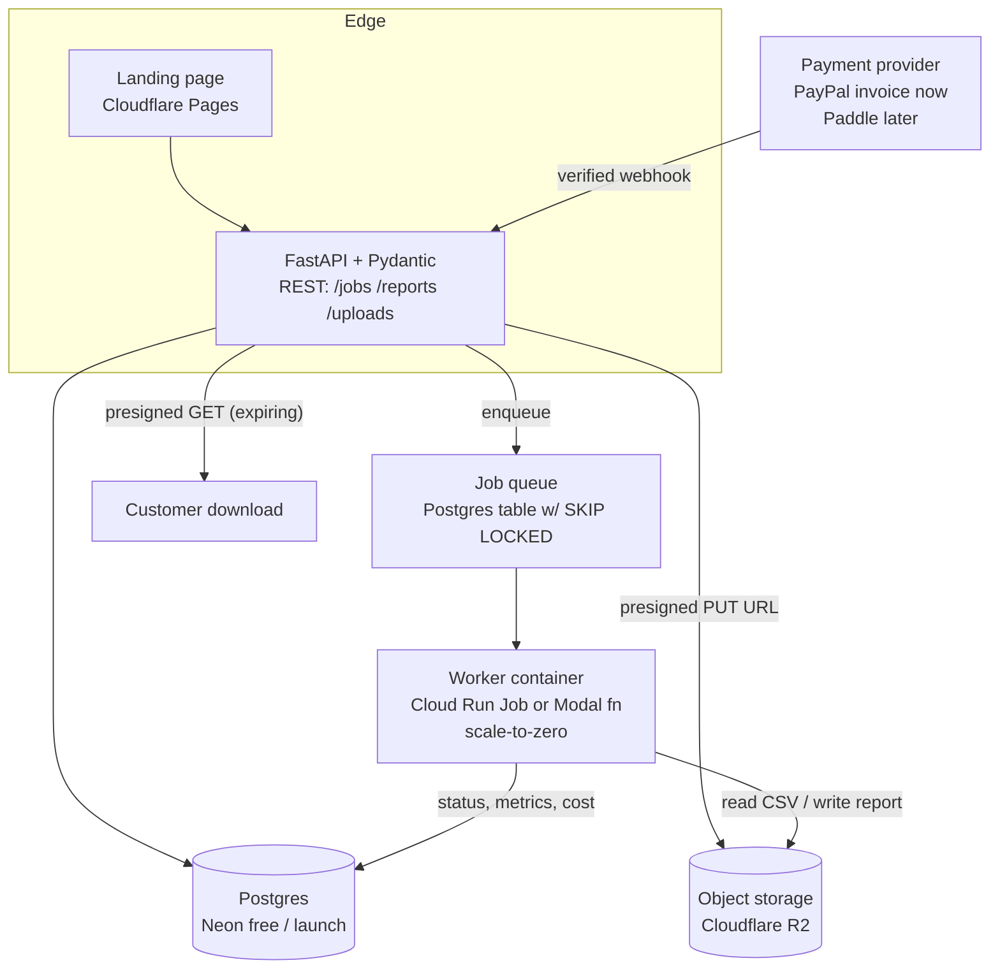

# Technical Architecture — QuantEval Cloud

Version 0.1 · 2026-10-10 (Asia/Taipei) · Companion docs: `mvp-prd.md`, `first-task-summary.md` (Milestone 1), `unit-economics.md`, `stage-gate-criteria.md`, `launch-risk-register.md`.

Design principle: **build only what the current stage needs.** Each later stage is gated by evidence (see `stage-gate-criteria.md`). Prices quoted are from official pages fetched 2026-10-10; see `unit-economics.md` for the cost model.

## Status
| Stage | Scope | Status |
|---|---|---|
| Stage 2: concierge CLI | Python package + `quanteval run` CLI, HTML/PDF report, manifest | **In progress** (Milestone 1, being built by another worker; not verified in this doc) |
| Stage 2b: Streamlit demo | Local/internal demo UI over the CLI | Unimplemented |
| Stage 3: async API service | FastAPI + Pydantic + Postgres + object storage + container jobs | Unimplemented (design only) |
| Stage 5: cost controls | Quotas, budgets, alerts, per-job cost metering | Unimplemented (design only) |
| Stage 6: multi-tenant SaaS | Auth, org isolation, billing entitlements, audit logs | Unimplemented; **gated** on Stage 9 thresholds |

---

## 1. Stage 2 — Concierge CLI (now)

```mermaid
flowchart LR
  C[Customer] -- "CSV via email or expiring private upload link" --> F[Founder]
  F -- "quanteval run --csv data.csv --horizon 5 --out out/" --> CLI[quanteval CLI\n(founder machine or box)]
  CLI --> V[validate.py\nOHLCV contract + DQ warnings]
  V --> S[splits.py\nwalk-forward + embargo\n+ pretraining-shadow flag]
  S --> M[models: naive · ARIMA · Kronos-mini\npinned HF revisions, CPU, fixed seed]
  M --> MET[metrics.py\nMAE RMSE MASE DA+CI DM latency]
  MET --> BT[backtest.py\n≥1-bar delay, bps costs,\nvalidity gates]
  BT --> R[report/: HTML + PDF + manifest.json]
  R -- "expiring link or attachment" --> C
  R -. "aggregate cost/time log (no customer data)" .-> L[(ops log)]
```

- Runs on the founder's machine or this box; **no cloud services required**. Customer files live on an encrypted volume and are deleted per the retention policy in `mvp-prd.md` §6 (30 days, to be confirmed in the pilot agreement).
- Reproducibility: `manifest.json` (input SHA-256, config, code git SHA, package versions, HF revisions, seeds, hardware, wall times).
- CI: GitHub Actions on Linux runners, unit tests + forbidden-word lint + dependency license gate (blocks GPL / Commons Clause, see legal checklist). Public repos get free standard runners; private repos get 2,000 free minutes/month on GitHub Free (https://docs.github.com/en/billing/concepts/product-billing/github-actions).
- **Streamlit (Stage 2b, optional):** a local-only UI that wraps the same CLI functions for live demos on discovery calls. Not internet-exposed. Only after M1 passes.

## 2. Stage 3 — Async evaluation service (after first paid pilots)

Goal: remove founder labour from the run step, still behind founder-controlled access (single tenant, invite-only).



| Component | Choice | Why | Cost basis (see `unit-economics.md`) |
|---|---|---|---|
| API | FastAPI + Pydantic v2 | Typed request/response contracts; founder has FastAPI code in EvalForge (proprietary, own reuse OK) | Runs on Cloud Run service (scale-to-zero) or the optional Hetzner box |
| DB | Postgres (Neon Free: 100 CU-hours/project, 1 GB storage, scale-to-zero after 5 min) | Jobs, manifests, metrics, audit log | https://neon.com/pricing |
| Queue | Postgres `jobs` table with `SELECT … FOR UPDATE SKIP LOCKED` | No extra service at low volume | 0 |
| Object storage | Cloudflare R2 (10 GB-month free, free egress) | Uploads, reports | https://developers.cloudflare.com/r2/pricing/ |
| Worker | Docker image, CPU-only torch; **Cloud Run Jobs** (free 240k vCPU-s + 450k GiB-s/month; Taiwan asia-east1 is Tier 1) or **Modal** (CPU US$0.0000131/core-s, Starter includes US$30/month compute) | Scale-to-zero, pay per second | https://cloud.google.com/run/pricing ; https://modal.com/pricing |
| GPU | Not used. Kronos-mini runs on CPU (informal smoke test 0.32–0.58 s per 24-step forecast, 4 threads; `repository-audit.md`). Runpod/Modal GPU only if a measured need appears. | Cost | — |
| CI/CD | GitHub Actions: test → build image → push to registry → deploy (manual approval step) | | GitHub Free minutes above |
| Payments | `PaymentProvider` interface: `create_invoice`, `verify_webhook`, `get_entitlement`. Adapters: `ManualInvoice` (PayPal/wire, admin marks paid), `Paddle` (only after pre-approval) | Stripe unavailable in Taiwan; avoid lock-in | `commercial-feasibility.md` §3 |
| Errors | Sentry Developer (free, 5k errors) | | https://sentry.io/pricing/ |

Job state machine: `uploaded → validated → queued → running → succeeded | failed | cancelled → expired (artifacts deleted)`. Every transition is written to an append-only `job_events` table.

Model artifact handling: weights are downloaded from Hugging Face at pinned revisions at image build time and baked into the image (not redistributed publicly; image registry is private). This keeps cold starts predictable and honours the legal-checklist advice not to redistribute weights.

## 3. Stage 5 — Cost controls (designed now, built with Stage 3)

| Control | Mechanism | Default (hypothesis) |
|---|---|---|
| Per-job hard limits | Max rows, max file size, max origins × samples, worker timeout | 500k rows, 50 MB (PRD), 50 origins × 5 samples, 30-min timeout |
| Pre-flight cost estimate | `est_seconds = n_origins × n_samples × t_forecast(context) + arima_time`; reject or require admin approval if above budget | Calibrate t_forecast from M1 measurements |
| Concurrency cap | Max N concurrent workers (Cloud Run Job parallelism / Modal concurrency) | N = 2 |
| Per-customer quotas | Jobs/month by entitlement (Offer B/C limits) | See `pricing-experiments.md` |
| Cloud budgets | GCP budget alert; Modal workspace budget; Neon spending notifications (paid plans) | Alert at 50 %/90 % of US$30/month infra |
| Cost metering | Worker records wall time × vCPU × GiB → `job_cost_usd` in Postgres | Feeds `unit-economics.md` |
| Storage lifecycle | R2 lifecycle rule deletes uploads after 30 days, reports after 90 days unless retained by contract | Policy to confirm with lawyer |
| Kill switch | Env flag disables job intake | — |

## 4. Stage 6 — Multi-tenant SaaS (only after the Stage 9 gate passes)

```mermaid
flowchart TB
  U[User] --> AUTH[Auth\nmanaged OIDC / magic link]
  AUTH --> API[FastAPI]
  API --> RL[Rate limiter\nper IP + per API key]
  API --> AZ{AuthZ:\norg_id from token,\nnever from request body}
  AZ --> PG[(Postgres with\nRow-Level Security\norg_id on every row)]
  AZ --> OS[(R2: prefix org/{org_id}/…\nper-object presigned URLs)]
  API --> AL[(audit_log append-only)]
  BILL[Paddle webhook\nsignature verified] --> ENT[entitlements]
  ENT --> API
  MON[Sentry + uptime + log alerts] -.-> API
```

| Requirement (brief) | Design | Verification |
|---|---|---|
| User authentication | Managed auth (Neon Auth / Better Auth or equivalent OIDC); no home-grown password storage | Auth tests; session expiry tests |
| Organization isolation | `org_id` column on every tenant table + Postgres RLS policies; `org_id` derived only from verified token | **Tenant isolation test suite**: user in org A attempts read/write/list/delete of org B datasets, reports, jobs, API keys via API and presigned URLs → all must 404/403; runs in CI on every PR |
| Secure file upload | Presigned PUT with content-length limit; server-side validation before job creation: size, CSV parse, column schema, row cap, no formulas executed, UTF-8 only; files never served back except to owner | Fuzz tests with malformed CSVs, CSV-injection strings, oversized files |
| Job queue | Stage 3 queue + per-org fairness | Load test |
| Usage quotas / billing entitlements | `entitlements(org_id, plan, jobs_per_month, max_rows)` updated only by verified webhooks | Quota enforcement tests |
| Experiment history | `jobs` + `manifests` tables scoped by org | Isolation tests |
| Downloadable reports | Short-lived presigned GET (≤ 15 min, *assumption*) | Expiry test |
| Account deletion | Hard-delete org data in Postgres + R2 prefix within N days; audit record retained without content | Deletion test |
| API keys | Random 32-byte keys, stored as hashes (SHA-256 + prefix for lookup), shown once, scoped to org, revocable | Key-leak test: key from org A rejected for org B |
| Audit logs | Append-only table: actor, org, action, target, timestamp, IP | Tests that every mutating endpoint writes an event |
| Secret scanning | gitleaks in CI (already used in audit) + GitHub secret scanning on the repo | CI gate |
| Rate limiting | Per-IP and per-key token bucket at the API (and Cloudflare in front if used) | Tests |
| Data retention | Defaults as Stage 5; configurable per contract; documented in privacy policy (lawyer review) | Lifecycle tests |
| Billing webhook verification | Verify provider signature + timestamp tolerance + idempotency key; reject unsigned | Replay and forged-signature tests |
| Error monitoring | Sentry with PII scrubbing (no CSV contents in events) | Config review |
| Backup and restore | Neon point-in-time restore window (6 h Free / up to 7 days Launch per pricing page) + nightly logical dump to a separate R2 bucket; **quarterly restore drill** with a documented runbook | Drill log |

Non-negotiable: **no user can access another customer's dataset, reports, or API credentials.** The tenant-isolation suite is a release blocker.

## 5. Security baseline across all stages
- Secrets only in environment/secret managers; `.env` gitignored; gitleaks pre-commit.
- Dependency pinning + license gate + `pip-audit` in CI.
- No customer data in logs, git, sample reports, or marketing.
- Report compliance lint (forbidden words) in CI.
- Principle of least privilege for cloud service accounts.

## Unverified assumptions
1. Postgres-as-queue is sufficient up to ~1,000 jobs/month (heuristic).
2. A CPU-only Docker image with torch fits Cloud Run/Modal cold-start expectations (image size and cold-start time unmeasured).
3. Neon free-tier CU-hours suffice for Stage 3 traffic.
4. Managed auth option chosen later meets enterprise SSO asks (Persona 3) — not evaluated.
5. 30-minute worker timeout covers a full report; actual runtime comes from Milestone 1.
6. Third-party prices may change; re-check before any spend (each spend needs founder approval).
